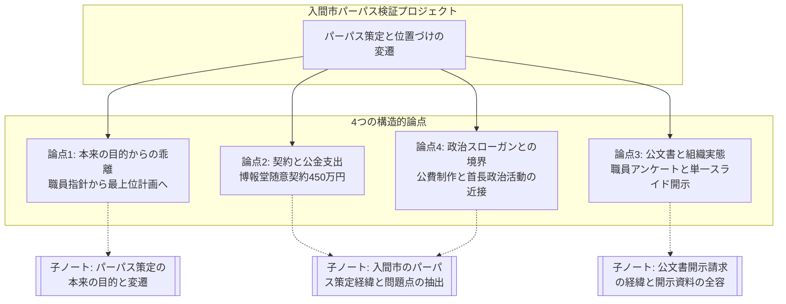
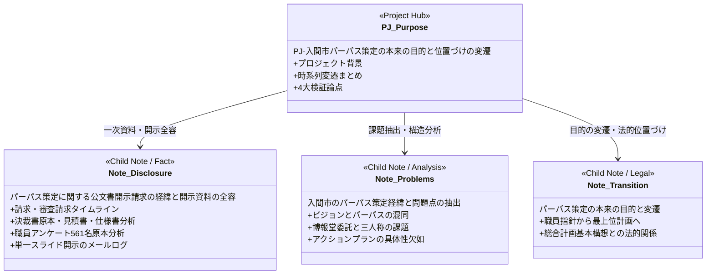

> [!important] プロジェクト検証ハブ
> 本ノートは、入間市が2023年に発表した自治体パーパス（存在意義）「心豊かでいられる、『未来の原風景』を創造し伝承する」について、その発端から現在に至る政策的・行政的な変遷と構造的課題を検証する総合ハブ記事です。

---

# 入間市パーパス策定の本来の目的と位置づけの変遷

## 1. プロジェクトの背景と問題意識

近年、民間企業のブランディング手法である「パーパス（存在意義）」を自治体経営に導入する試みが注目を集めています。埼玉県入間市は2023年5月、「埼玉県内の自治体で初」と銘打ち、公式パーパスとして**「心豊かでいられる、『未来の原風景』を創造し伝承する」**を大々的に発表しました。

しかし、その策定過程および市政における位置づけを綿密に追っていくと、地方自治の根幹に関わる重大な構造的疑問が浮かび上がります。

1. **「職員の行動指針」から「市政の最上位計画」への変質:**
   当初は市役所職員が日々の業務に向き合うためのインナーブランディング（職員向け指針）として構想されたものが、いつの間にか議会の議決を要する「入間市総合計画」の基本構想をも包含・規定する「最上位概念」へと昇格・拡大したプロセス。
2. **意思決定プロセスの不透明さと外部委託:**
   公募型プロポーザル等の競争入札を経ず、株式会社博報堂との随意契約（税別450万円／税込495万円）によって進められた策定業務の実態と、市民参加・職員参画の実効性。
3. **公文書開示請求で判明したガバナンスと公文書管理の現実:**
   当初の「不存在」「ノウハウ非開示」処分に対する審査請求を経て開示された資料において、職員アンケートに記された現場の率直な疲弊感、そして意思形成過程の記録が極めて限定的である実態。
4. **政治的スローガンとの境界線の曖昧さ:**
   公費を投じて策定された理念フレーズが、首長の政治活動や支援組織の名称等と不可分に重なり合っていることへの疑義。

本プロジェクトでは、感情的な批判を排し、開示された公文書原本、市議会会議録、事業者作成資料、公式発表資料などの客観的ファクトに基づき、自治体パーパスがいかなる変遷をたどり、どのような課題を内包しているのかを立体的に検証します。

---

## 2. 時系列で見る位置づけの変遷

パーパスがどのような意図で始まり、いかにして現在の「最上位概念」へ至ったのか、公文書と公的記録に基づくタイムラインは以下の通りです。

| 時期 | 区分・出来事 | パーパスの本来の目的・位置づけ | 根拠公文書・発言等 |
| :--- | :--- | :--- | :--- |
| **2021年8月** | **職員ワークショップの開催** | **市役所職員のためのインナー指針** 日常業務の原点を見つめ直し、職員一人ひとりのモチベーションを高めるための庁内対話。 | 伺書管理番号308号「ワークショップの開催について（伺い）」 ※博報堂・ネクソン担当者がファシリテーターとして参画 |
| **2022年4月** | **未来共創推進室の設置** | **組織主導から首長直轄・外部アドバイザー主導へ** 市長直轄組織として設置され、本市の未来構想の議論が本格化。 | 起案文書46557号に「市長及び外部アドバイザーと共に議論を進めてきました」と明記 |
| **2022年12月** | **博報堂への業務委託見積** | **プロモーションを前提とした概念規定** 「社会と共有できるビジョン」としてのパーパス策定および動画制作企画。 | 博報堂見積書（小計766万円、調整値引き▲316万円、税別450万円）および業務仕様書特記条件 |
| **2023年3月** | **パーパス策定の正式決裁** | **市政全体の共通ビジョン** 文言「心豊かでいられる、『未来の原風景』を創造し伝承する」が市長以下22名の押印で決裁完了。 | 企画課未来共創推進室起案「パーパスの策定について（伺い）」（文書管理番号46557） |
| **2023年4月〜5月** | **庁内発表・プレスリリース** | **対外的な自治体ブランド** 部長職向け説明、全職員発表会を経て、PR TIMES等で「県内自治体初」として対外発信。 | 『パーパス発表会.pdf』スライド、PR TIMES配信リリース（2023年5月1日） |
| **2023年9月〜** | **市議会定例会での質疑** | **総合計画の最上段・包含概念** 市長答弁にて「総合計画の上位概念」「すべての施策を導く羅針盤」と説明される。 | 令和5年9月第3回定例会 議事録（杉島市長答弁等） |
| **2026年** | **公文書開示請求・審査請求** | **公文書管理と説明責任の検証** 策定プロセスの透明性を問う審査請求を経て、原本・アンケート・開示データが開示される。 | 審査請求認容開示資料、入間市未来共創政策推進室回答ログ |

---

## 3. 本プロジェクトにおける4大検証論点

本プロジェクトでは、収集された一次資料に基づき、以下の4つの切り口から構造的分析を行っています。

### 論点1：本来の目的（職員指針）からの乖離と「最上位計画」への変質
* **職員の生活実感の消失:** 2021年のワークショップにおいて職員から提案された言葉は、「住生活を快適させるまち」「非日常を実現させるまち」など、具体的で地に足のついたものでした。しかし、完成したパーパスは極めて抽象的で概念的なスローガンへと変化しました。
* **自治体法制とのねじれ:** 地方自治法第2条に基づき、自治体の基本構想は「市議会の議決」を要する最高意思決定です。しかし、パーパスは議会の議決を経ず、市長決裁と民間コンサルティングによって策定されました。そのパーパスが「総合計画の最上段に位置し、総合計画を包含する」と位置づけられたことで、**「議会の審議を経た基本計画よりも、行政内部で決めたパーパスが上位に立つ」というガバナンス上の逆転現象**が生じています。
* **三人称（市民）の不在:** 当初から関与した博報堂の担当者自身が、「市長に入間市はどうありたいかと聞いた際、鋭い答えがあるものの、それが入間市役所の一人称になっており、三人称（市民目線）ではなかった」と課題を指摘していました。結果として、市民不在のまま「市役所が掲げる理想」が市民へ向けて一方的に発信される構造となりました。

### 論点2：公金支出の妥当性と民間委託（随意契約）のプロセス
* **随意契約の仕様書設計:** 業務委託（契約額：税別450万円／税込495万円）にあたり、仕様書には「パーパス策定の経緯や内容について熟知し、未来共創推進室の意図を正確にプロモーションできる業者」との特記条件が付され、事実上、博報堂を指定する随意契約となっていました。
* **大幅な調整値引きの背景:** 博報堂の見積書（2022年12月1日付）では、当初の定価総額が766万円（プランニング250万円、動画制作516万円）であったのに対し、「▲316万円」という巨額の調整値引きが行われ、予算上限額である450万円に収められています。
* **成果物の費用対効果（ROI）:** 報告書（公文書管理番号571号）として納品・開示された文書の実体は「YouTube動画のURLが1行記されたテキストファイル」であり、450万円の公費支出に見合う政策的検証や市民生活への直接的リターンがどこまで検証されたのかが問われています。

### 論点3：公文書開示請求が暴いた統治機構と現場の現実
* **審査請求と開示の実態:** 2023年夏の「不存在」「ノウハウ非開示」処分に対し、2026年4月に提起された行政不服審査請求において、総務省運用基準や広島市審査会答申等を論拠に不開示の違法性を追及。市は処分を見直し開示決定を行いました。
* **「単一スライド使い回し開示」による公文書管理の形骸化:** 審査請求認容後に開示されたデータでは、打合せ議事録（568号）、事業者報告書（571号）、事前メール履歴（575号）など、全く異なる名目の公文書請求に対して、すべて同一の『パーパス発表会.pdf』（SHA256ハッシュ完全一致）が割り当てられていました。市は「誤りではなく、これが特定公文書である」と回答しており、意思形成プロセスの公文書が適切に保存・管理されていない実態が浮き彫りになりました。
* **職員アンケートが示す組織の疲弊:** 開示されたスライド内に収録されていた全庁アンケート（回答561名）には、「やりがいは感じない。割り切っている」「場当たり的、その場しのぎの施策展開」「極少数派への配慮で全体サービスが低下」「予算も人員も余裕もない」といった切実な現場の声が記録されていました。理念先行のスローガンと、疲弊する現場職員の意識との間に深刻な乖離が存在します。

### 論点4：政治的スローガンとの境界線
* **首長の後援会活動との近接性:** 「未来の原風景」という文言は、自治体パーパスにとどまらず、首長を支援する政治活動組織（「あすの原風景を未来に贈る会」）や後援会広報などでも類似・重複して用いられています。
* **公金の公私混同をめぐる懸念:** 公費（市民の税金）を用いて策定・制作されたパーパスムービー等の成果物が、後援会チラシ等に連絡先と並んで掲載されていた実態など、公の行政活動と政治家の個人広報との境界線が極めて曖昧になっている点が指摘されています。

---

## 4. プロジェクトの構成と子ノートへのナビゲーション

本プロジェクトは、テーマごとの詳細な調査・分析ノートと有機的に連携しています。各論点の詳細なファクトと公文書原本の検証については、以下のリンク先を参照してください。

### 🔗 子ノート・詳細検証記事一覧

1. **[[パーパス策定に関する公文書開示請求の経緯と開示資料の全容]]**
   * **内容:** 情報公開請求から不開示決定、審査請求書の論理構成、認容決定、そして受領した公文書原本（決裁文書原本46557号、見積書、特記仕様書、職員アンケート561名、メール送受信ログ）の全貌を網羅したファクトベースの調査記録。
2. **[[入間市のパーパス策定経緯と問題点の抽出]]**
   * **内容:** 博報堂への委託経緯、パーパスとビジョンの混同、宛先のズレ（一人称と三人称）、施策の具体性欠如など、政策形成論・ブランディング論の観点から問題点を抽出・分析した論考。
3. **[[パーパス策定の本来の目的と変遷]]**
   * **内容:** 2021年の職員ワークショップから総合計画最上位への「昇格」に至る軌跡と、議会審議（基本構想）との関係性を掘り下げた法制・ガバナンス分析。

### 📁 一次公文書・証拠資料アーカイブ（直接リンク）

* [決裁文書原本：パーパスの策定について（伺い）PDF](file:///d:/iruma_mielka/_99_Legacy_Archive/データ/開示請求/公開用/202608開示請求/パーパス/504号（パーパス決定の決裁文書ならびに議事録）/504号（パーパス決定の決裁文書ならびに議事録）/20230329_パーパス策定の起案文書.pdf)
* [開示スライド原本：『パーパス発表会.pdf』（職員アンケート・対談掲載）](file:///d:/iruma_mielka/_99_Legacy_Archive/データ/開示請求/公開用/202608開示請求/パーパス/504号（パーパス決定の決裁文書ならびに議事録）/504号（パーパス決定の決裁文書ならびに議事録）/パーパス発表会.pdf)
* [博報堂見積書原本：小計766万円／調整▲316万円（PDF）](file:///d:/iruma_mielka/_99_Legacy_Archive/データ/開示請求/公開用/2023開示請求/パーパス/214-02見積書.pdf)
* [業務委託仕様書原本：特記条件記載（PDF）](file:///d:/iruma_mielka/_99_Legacy_Archive/データ/開示請求/公開用/2023開示請求/パーパス/214-03仕様書.pdf)
* [市民からの意見・要望書（PDF）](file:///d:/iruma_mielka/_99_Legacy_Archive/データ/開示請求/公開用/2023開示請求夏/パーパス関連/)

---

## 5. 総括と今後の追究課題

パーパスそれ自体は、組織の結束や方向性を定める上で有効な概念となり得ます。しかし入間市の事例において浮き彫りになったのは、**「現場職員の切実な声や市民の生活課題から遊離したまま、外部コンサルタントと首長直轄室の主導で抽象的な理念がトップダウンで決定され、それが議会制民主主義の最高規範である基本構想をも凌駕する最上位概念へとすり替えられていった」**というプロセスです。

本プロジェクトでは今後も以下の点について継続的な検証を行っていきます。

* [ ] 次期総合計画の策定・改定において、パーパスがどのような法的・位置づけで扱われ続けるかの監視
* [ ] 450万円のプロモーション委託を通じて制作された動画やツールが、実際のシティプロモーションや定住人口増にどれほどの効果をもたらしたかの定量評価
* [ ] 公文書開示において単一スライドが複数請求に充当された問題について、庁内の公文書管理規則および適正な行政記録の作成義務に関する議会等を通じた追究状況の確認
* [ ] 自治体行政における「民間経営手法の安易な導入」がもたらす副作用と、本来あるべき市民参加型ガバナンスのあり方の提言

